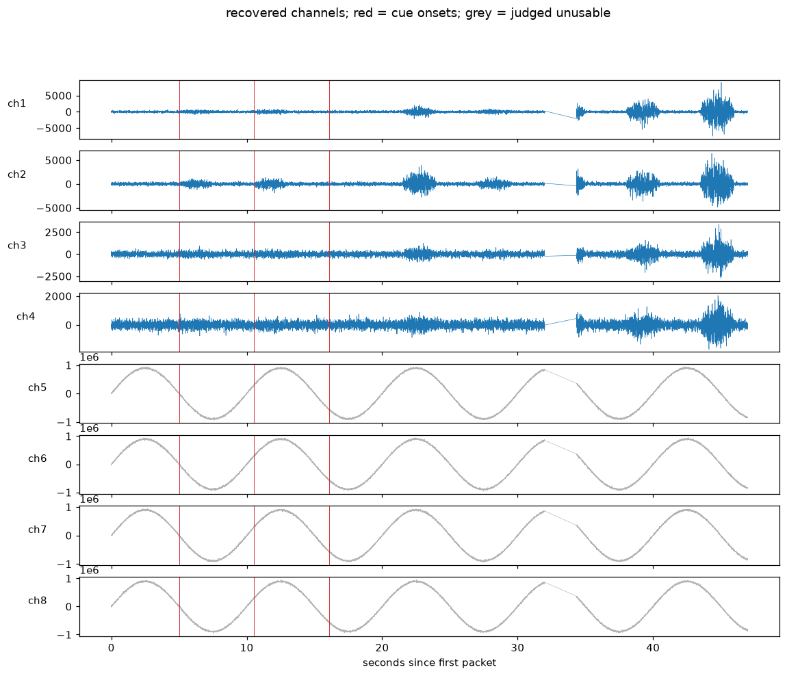

# partial

**Reconstruct a damaged biosignal recording from its raw serial tape, and say which parts you saw and which parts you guessed.**

Built on 7 November 2026 at the AIE Code Summit 2026 Hackathon (Shack15, San Francisco) for the **Software Archaeology** track, on the Meta Model API (`muse-spark-1.3`). Carl Kho, Somach Systems, Inc.

## What it does

A small research board (a Cerelog, eight channels of ADS1299 at 250 samples per second) streams a proprietary 37-byte packet over USB serial. Every recording session saves the raw bytes to `tape.bin` before anything is parsed, plus three text files: the metadata (`meta.json`), the cue log (`events.csv`, which trial started when) and the host read log (`reads.csv`, which relates the laptop clock to the board clock).

Sessions rot. The metadata gets lost, the cue log gets cut off, the read log gets deleted, the tape gets a few corrupted bytes or a chunk missing. There is no datasheet in the folder and no driver source.

`partial` hands a damaged folder to an agent with eight tools (list files, read text, hex dump, byte histogram, find a byte pattern, write a file, run a Python script, summarise an array) and asks it to:

1. reverse the wire format from the bytes: sync markers, packet length, where the timestamp is, how many channels, sample width and endianness, the checksum rule;
2. write and run its own `parse_tape.py`, which has to resynchronise after the damage;
3. recover the sample rate, volts per count, which channels carry a real signal, and the trial labels and onsets that can still be grounded;
4. draw the channels with the cue onsets marked;
5. write `reconstruction.json`, where **every claim** is an object:

```json
{"value": 37, "status": "observed", "evidence": "AB CD sync markers repeat every 37 bytes", "confidence": 0.98}
```

`observed` means verified against the bytes or files in that folder. `inferred` means a guess, and the evidence has to say why. A trial whose label did not survive gets `null` with status `inferred`; the agent is told never to invent one.

Then a **held-out oracle** scores it. The oracle is a compact port of the real protocol (the vendor's BrainFlow driver format and the October parser from the private recording repo). The agent never sees it. The scorer parses the same damaged tape with the oracle and checks packet count, timestamp set and byte-identical samples; then checks each claim against the untouched session; then checks the labels, where a wrong label marked `observed` costs double; then checks that every claim carries the full contract.

## Why a biosignal tape is archaeology

The track asks for recovery from "binaries, runtime traces, partial code or documentation" with "behavioral evidence that separates what was observed from what was inferred". A serial capture is a runtime trace of a program nobody has the source for (the board's firmware). The parser the agent writes is a rebuilt port of the host driver. Behavioral equivalence is measurable: its parse either matches the real driver's parse byte for byte or it does not. And the observed/inferred split is not decoration; it is the difference between "the clock steps 4 ms, so 250 Hz" and "I assumed gain 24 because that is the chip's default".

## Quickstart

```bash
uv venv && source .venv/bin/activate
uv pip install -e ".[dev]"
cp .env.example .env            # MODEL_API_KEY=LLM_... from dev.meta.ai, API keys
pytest -q                       # 8 tests, about a second, no network

partial demo --fake-model       # whole pipeline with a scripted stand-in, no key
partial demo                    # the same on the Meta Model API
```

Step by step:

```bash
partial synth --out data/s1 --trials 8            # a session in the real shape, no hardware
partial corrupt data/s1 --out data/s1-damaged     # drop meta, cut cues, strip reads, cut and garble the tape
partial reconstruct data/s1-damaged               # the agent (add --fake-model for the stand-in)
partial score data/s1-damaged --truth data/s1     # the table below
```

`examples/` holds one synthetic session and its damaged twin (seed 20261107), the damage report, and the figure the stand-in produced.

## What the scorer prints

The stand-in run on the example (meta deleted, 5 of 8 cue rows gone, read log deleted, 21,737 bytes cut out of the tape, 40 bytes garbled):

```
check                      agent                   truth                   score
packets recovered          11122                   11122                   1.00
timestamps matched         11122                   11122                   1.00
samples byte-identical     1.000                   1.000                   1.00
packet length              37                      37                      1.00
start marker               ABCD                    ABCD                    1.00
end marker                 DCBA                    DCBA                    1.00
channels                   8                       8                       1.00
sample encoding            int24 big-endian, two'  int24 big-endian        1.00
checksum rule              sum(bytes[2:34])&0xffa  sum(bytes[2:34])&0xFF   1.00
sample rate (Hz)           250.0                   250.0                   1.00
volts per count            2.235e-08               2.235e-08               1.00
usable channels            [1, 2, 3, 4]            [1, 2, 3, 4]            1.00
trial labels               3/8                     8                       0.38
claims with full contract  18/18                   18                      1.00
TOTAL                                                                      0.95
```

The 3 of 8 on labels is the honest ceiling: five labels left no trace in the folder, and the stand-in did not make them up. The Meta model's own run is reported separately once the key is live; the stand-in exists so the loop, the tools and the scorer are tested without a network.



The straight line near 32 seconds is the cut: the parser resynchronised on the other side of it. Channels 5 to 8 are floating inputs, judged unusable from their drift.

## What was built today, and what was not

Hackathon rule: judges must see the day's contribution.

Built today, in this repository:
- `synth.py`: a synthetic session in the real file shapes, with no hardware.
- `corrupt.py`: five named, seeded kinds of damage, with the report kept outside the folder.
- `tools.py`: the eight sandboxed tools (every path resolved inside the session folder; scripts run with `python -I` and a timeout).
- `agent.py`: the tool-calling loop on the Meta Model API, the system prompt with the observed/inferred contract, the run log, and the scripted stand-in.
- `score.py`: the behavioral-equivalence scorer and its table.
- `oracle/cerelog_ref.py`: the compact held-out port of the protocol (about 80 lines).
- `cli.py`, the tests, this README.

Prior work, not part of the entry: the Cerelog board, its firmware, the October 2026 driver port and recording pipeline (`silent-speech-cerelog`, private) and the data recorded with it. The oracle restates that protocol so the scorer has ground truth; the agent is never shown it.

## Meta Model API

`meta_client.py` uses the OpenAI-compatible chat completions endpoint at `https://api.meta.ai/v1` with function tools and `tool_choice="auto"` (the only value the API accepts). Default model `muse-spark-1.3`; override with `--model` or `PARTIAL_MODEL`.

## Limits

- The stand-in is a fixed transcript of a good run; it tests the plumbing, not the model. Scores from `--fake-model` say nothing about Muse.
- The synthetic signal is simple (band-limited bursts on four wired channels, slow drift on four floating ones). Real tapes have mains, motion and electrode pops.
- Volts per count cannot be read off the tape at all; the oracle knows it from the firmware constant. A fair reconstruction marks it `inferred` unless `meta.json` survived.
- The scorer rewards the protocol the oracle knows. A different board needs a different oracle.
- Real sessions from the private repo are not included; `partial score` works on them unchanged if you have one.

## First real run on Muse Spark 1.3 (7 Nov 2026, 15:0x PT)

Same damaged example, live model, 43 tool steps, 535 s. The agent's parser recovered all 11,122 surviving packets with samples byte-identical to the oracle, named the sync markers, packet length, channel count, checksum rule and 250 Hz rate, and kept the four usable channels. It declined to claim volts per count (correct to not guess, scored 0 against the truth), and grounded 3 of 8 trial labels, which is every label that survived the cut cue log. Total 0.88. Artefacts: `examples/muse-run-2026-11-07/` (reconstruction.json, the parser it wrote, the figure, the log).
